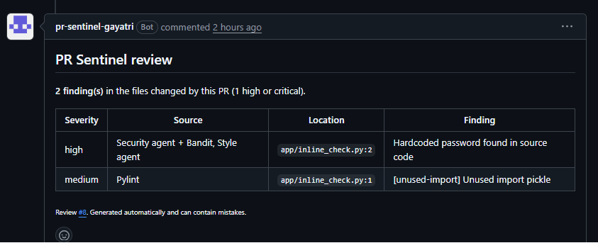
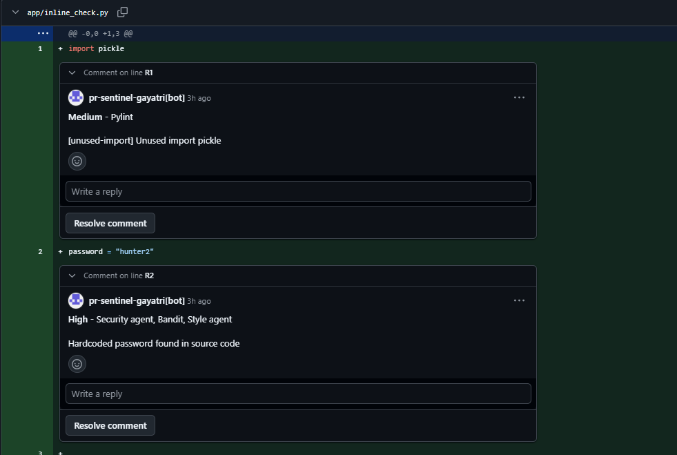
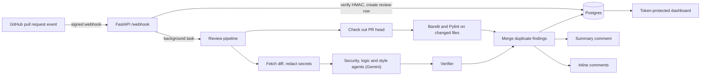

# PR Sentinel


An AI code-review GitHub App. When a pull request is opened or updated, PR Sentinel reviews the changed code with three LLM agents (security, logic, style) and two static analysers (Bandit, Pylint), then posts what it found on the PR: one summary comment that updates in place, and inline comments on the exact changed lines.

It is deployed and running: [pr-sentinel-kfk0.onrender.com/health](https://pr-sentinel-kfk0.onrender.com/health) (free tier, so the first request after idle can take about 50 seconds).




## What it does

- **Reviews only what changed.** Static analysis runs on the PR's changed Python files; the agents review the PR diff.
- **Three LLM agents** (Gemini 3.6 Flash, JSON mode): security, logic and style, each with its own prompt.
- **Verifier pass.** AI findings go through a second LLM check; ones it cannot confirm are collapsed in the comment instead of shown as facts. Bandit and Pylint results are deterministic and are not re-checked.
- **One finding, one row.** When several tools report the same problem on the same line (for example a hardcoded password), they are merged into a single entry that lists every tool that agreed.
- **Summary comment that updates in place** (found by a hidden marker), so a PR never fills up with one comment per push.
- **Inline comments** on the changed line for verified findings of medium severity or higher (at most 8 per run, most severe first, never repeated on later pushes).
- **Observability dashboard** (latency, tokens and false-positive rate per agent, findings by severity) backed by a Postgres `llm_usage` table with token counts and estimated cost.

## How it works



## Design decisions

- **Webhook signatures.** Every webhook body is checked with HMAC-SHA256 against the raw bytes before it is parsed; anything else gets a 401.
- **LLM output is untrusted.** Each finding is validated before use (must be an object with file, line, severity and message), and malformed ones are dropped and counted instead of crashing the review. Text that goes into GitHub markdown is escaped and `@mentions` are defused.
- **Secrets never reach the model.** Diffs pass through a secret-redaction step first.
- **Degrades instead of failing.** Per-agent status (`ok`, `quota_exhausted`, `error`) is tracked; if Gemini is out of quota or down, Bandit and Pylint results are still delivered and the comment says the AI part was incomplete.
- **Cost control.** Gemini "thinking" tokens are billed as output, so thinking is set to `minimal` (about 5x cheaper in my measurements); every call's tokens and estimated cost are logged.
- **Access control.** `/reviews/{id}` and `/dashboard/data` require a bearer token (header only, never the URL); if no token is configured, everything is denied.
- **Resilience.** 60-second LLM timeout with retry on transient errors, and database `pool_pre_ping` so connections dropped by an idle serverless Postgres are replaced.

## Evaluation

I built a labelled benchmark to measure the pipeline instead of guessing. The held-out set (`eval/cases_v3.py`) has 30 files: 20 with one seeded bug each (including categories the prompts never name, such as XXE, CORS, SSTI and mass assignment) and 10 clean look-alikes. Each file was run 3 times; a finding counts if it is within 3 lines of the seeded bug.

| Variant | Bugs found | Precision | Clean files flagged |
|---|---|---|---|
| Bandit only | 35% | 88% | 10% |
| LLM agents only | 83% | 94% | 10% |
| **Full pipeline (agents + Bandit)** | **92%** (90-95% across runs) | 90% | 20% |

Full method, per-category results and misses: [`docs/evaluation_v3.md`](docs/evaluation_v3.md). A whole 90-run evaluation costs about 21 rupees (about $0.23) in Gemini usage.

What this does and does not show:
- The cases are synthetic and written by me, so real-world numbers will differ.
- Prompts were tuned on an earlier dev set (`cases_v2.py`); v3 was written afterwards and run once.
- The LLM verifier did not improve precision on either set, so I do not claim it does.

## Run it locally

```bash
python -m venv venv
venv\Scripts\activate            # macOS/Linux: source venv/bin/activate
pip install -r requirements.txt
docker compose up -d             # local Postgres
cp .env.example .env             # then fill in the values below
uvicorn app.main:app --reload --port 8000
```

Values in `.env`: `GITHUB_WEBHOOK_SECRET`, `GITHUB_APP_ID`, the GitHub App private key (see `app/github_auth.py`), `GEMINI_API_KEY`, `DATABASE_URL`, `DASHBOARD_TOKEN`. Optional: `LLM_THINKING_LEVEL` (default `minimal`).

GitHub cannot reach `localhost`, so relay webhooks with [smee.io](https://smee.io):

```bash
npm install --global smee-client
smee -u https://smee.io/YOUR_CHANNEL_ID -t http://localhost:8000/webhook
```

Open a pull request on a repo where the app is installed and watch the log.

## Tests

```bash
python -m pytest -q
```

63 tests run in GitHub Actions on every push and pull request. They cover webhook signature checks, bearer-token auth, orchestrator handling of malformed agent output, duplicate merging, the PR comment builder (sanitising and update-in-place), diff parsing and inline-comment selection. The tests use a throwaway SQLite database and fake credentials, so they never touch real services.

Run the benchmark (needs a real `GEMINI_API_KEY` and costs a little):

```bash
python -m eval.run_eval --set v3 --tag demo --repeats 3 --max-cost-inr 60
```

## Known limitations

- Jobs run in-process: if the server restarts mid-review, that review is lost. There is no webhook de-duplication (`X-GitHub-Delivery`) or durable queue yet.
- The repository is indexed into code chunks with embeddings, but the agents currently review the diff itself; retrieval-augmented review is not wired in yet.
- LLM usage is collected in a process-wide list, so two reviews running at the same time can mix their usage records.
- The free Render instance sleeps when idle, so the first request can be slow.
- Weak spots from the benchmark: mass-assignment and float-equality bugs are not reliably found, and a debatable SQL ORDER BY finding from Bandit counts as a false alarm.
- Python only for static analysis.

## Roadmap

- Durable job queue and webhook de-duplication
- Retrieval-augmented review using the existing index
- Per-repository configuration
- Installation on more real repositories, with collected feedback

## Stack

Python 3.12, FastAPI, SQLAlchemy, PostgreSQL (Neon), Gemini API, Bandit, Pylint, pytest, GitHub Actions, Docker, Render.